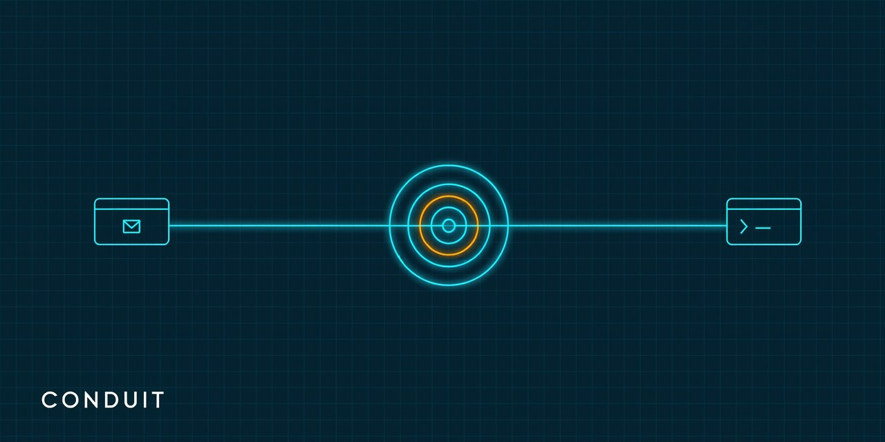

# Conduit



Conduit is a protocol and reference implementation that lets a client (a CLI, an IDE or an agent) reach the state inside an app, over a tunnel the user can see and revoke. Most apps give third parties no way in. Apple runs over four hundred app extensions that most users never see listed.

```
   the app                    the broker                    the client
┌──────────────────┐      ┌─────────────────────┐     ┌──────────────────┐
│  ┌────────────┐  │      │  registry           │     │  CLI / SDK       │
│  │ extension  │──┼──────┼─▶ scopes & grants   │◀┼────┼─▶ IDE / agent   │
│  │ (near end) │  │ WSS  │  schema registry    │     │  (far end)      │
│  └────────────┘  │◀─────┼─▶ typed relay       │     └──────────────────┘
└──────────────────┘      │  replay ring        │
                           │  (sees no payload)  │
                           └─────────────────────┘
```

The client never touches the app's process, memory or permissions. It gets only what the user granted. See [`docs/architecture.md`](docs/architecture.md) and [`docs/protocol.md`](docs/protocol.md).

## How it works

Each frame names a versioned reverse-DNS schema, such as `dev.conduit.mail.message/v1`. The broker refuses unknown frame types.

A surface offers scopes like `mail.compose.read`, the user grants some, and the broker refuses anything outside the grant, naming the missing scope.

Clients address channels as `conduit://<surface>/<channel>@v1`. Payloads are sealed end to end with `p256-aes256gcm/v1` (ECDH P-256, HKDF-SHA256, AES-256-GCM), so the broker never reads them.

The Rust lives in `crates/`, the Chromium and Safari extensions in `clients/`, the JSON Schemas in `spec/`, and the app survey in `docs/research/`.

## Running it

```sh
cargo test --workspace
node --test clients/shared/*.test.js
node scripts/browser-test.mjs       # sealing, in real Chromium
cargo run -p conduit-broker         # ws://127.0.0.1:8787/v1/tunnel
```

## Status

Built and tested: the protocol, the broker, the client library, the Safari native host, both extensions and one surface, the browser tab. Rust and browser sealing produce identical ciphertext for a shared test vector.

Not built: adapters for Mail, desktop apps or anything beyond the browser tab. Each app family needs its own.

Not verified: the full extension in Chrome. Its logic is tested against a mocked browser API, but nobody has watched a tunnel open in a real browser yet.

## Why the research came first

Chromium kills an idle service worker after 30 seconds, so the near end pings every 20 and resumes by sequence number. Safari unloads background pages just as fast and can't hold a WebSocket to `127.0.0.1`, so a native host holds it instead. Sources are in [`extension-surfaces.md`](docs/research/extension-surfaces.md).

## Licence

MIT or Apache-2.0, at your option. See [`LICENSE`](LICENSE) and [`LICENSE-APACHE`](LICENSE-APACHE).
