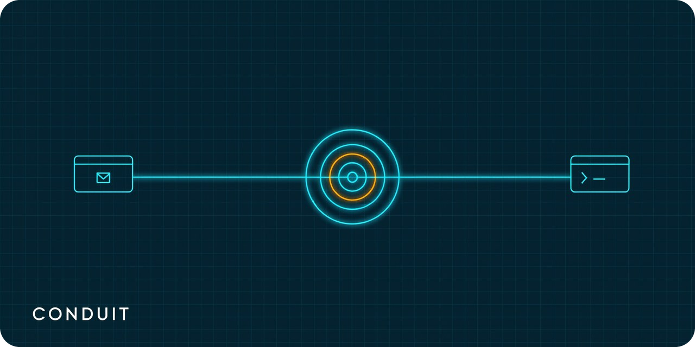

# conduit



most apps give third parties no way in. apple ships 400+ app extensions and most users never see the list.

conduit is a protocol + reference impl that lets a client (cli, ide, agent) reach state inside an app over a tunnel the user can see and revoke. the client never touches the app's process, memory or permissions; it gets what the user granted and nothing else.


more => [`docs/architecture.md`](docs/architecture.md), [`docs/protocol.md`](docs/protocol.md)

## the protocol

pair once => the extension asks the broker for a code, the user approves it on the broker's own page, the extension gets a 256-bit secret bound to exactly those scopes.



then both ends open a websocket to the broker and say hello. hello carries a public key + the last `seq` seen; on reconnect the broker replays what you missed from a ring of the last 256 frames. payloads stay sealed end to end and the broker refuses anything outside the grant.



## typed, scoped, schemed

- typed => every frame names a versioned reverse-dns schema, e.g. `dev.conduit.mail.message/v1`. unknown frame type: refused.
- scoped => a surface offers scopes (`mail.compose.read`), the user grants a subset, the broker enforces it. out of grant: refused, with the missing scope named.
- schemed => address is `conduit://<surface>/<channel>@v1`. seal is `p256-aes256gcm/v1` (ecdh p-256, hkdf-sha256, aes-256-gcm); the broker never opens it.

rust in `crates/`, chromium + safari extensions in `clients/`, json schemas in `spec/`, app survey in `docs/research/`.

## run it

```sh
cargo test --workspace
node --test clients/shared/*.test.js
node scripts/browser-test.mjs       # sealing, in real Chromium
cargo run -p conduit-broker         # ws://127.0.0.1:8787/v1/tunnel
```

## status

shipped + tested: protocol, broker, client lib, safari native host, both extensions, one surface (the browser tab). rust and browser sealing match byte for byte on a shared test vector.

not built: adapters for mail, desktop apps, anything past the browser tab. each app family needs its own.

not verified: the full extension in chrome. logic is tested against a mocked browser api; nobody has watched a tunnel open in a real browser yet.

## why research first

chromium and safari decided most of this. chromium kills an idle service worker after 30s => the near end pings every 20s and resumes by `seq`. safari unloads background pages about as fast and its websocket to `127.0.0.1` is broken => a native host holds the socket. sources: [`extension-surfaces.md`](docs/research/extension-surfaces.md)

## license

MIT or Apache-2.0, your pick. [`LICENSE`](LICENSE), [`LICENSE-APACHE`](LICENSE-APACHE)
